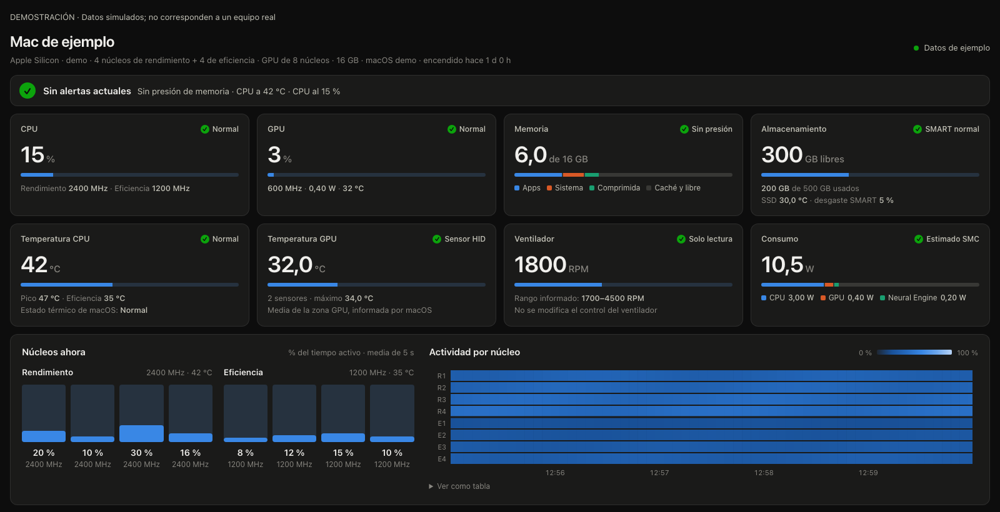

# Serverfiles

Configuración de un Mac como máquina de desarrollo remoto siempre encendida. La máquina de referencia es un Mac mini: compila, ejecuta terminales y edita código en remoto, y se accede a ella desde un MacBook o un iPad.

No hay instalador. Los ficheros de aquí son plantillas y guías que se adaptan a cada Mac durante la instalación (usuario, hostname, rutas y puertos se detectan en la máquina, no están escritos en el repo).

## Qué incluye

- **Acceso remoto al mini.** SSH (Remote Login de macOS), T3 Code con T3 Connect, Tailscale, Jump Desktop Connect y VS Code Remote Tunnels. El mini es el que recibe las conexiones; los clientes solo necesitan sus apps correspondientes.
- **Panel de monitorización propio.** Una página web privada (solo accesible dentro de la red Tailscale) con CPU y actividad por núcleo, GPU, memoria, temperaturas, ventilador, consumo, red y salud del SSD. Se monta sobre Netdata más lecturas propias de macOS (ver [docs/MONITORING.md](docs/MONITORING.md)).

  

  La imagen es una demostración con datos simulados, no una captura de la
  actividad, el almacenamiento o la red del servidor real.

- **El mismo panel en un MacBook.** El perfil de [monitorización](docs/MONITORING.md#use-the-same-panel-on-a-macbook) detecta su hardware, admite las temperaturas agregadas del M1 Pro y sus dos ventiladores, y publica el panel en una ruta privada propia. No aplica los ajustes de energía del mini al portátil.

- **Ajustes para que el mini sobreviva solo.** Inicio de sesión automático, energía (sin suspensión, rearranque tras corte de luz), qué apps se abren al iniciar sesión y qué servicios arrancan solos (ver [docs/MINI.md](docs/MINI.md)).
- **Guía de cliente para iPad.** Qué apps instalar y cómo conectarse al mini por SSH, T3 Code, VS Code Remote y escritorio remoto (ver [docs/IPAD.md](docs/IPAD.md)). Un Mac como cliente se configura desde dotfiles.

## Relación con dotfiles

Las herramientas compartidas (shell, Git, Neovim, CLI, apps de uso general) viven en [dotfiles](https://github.com/DavidPerezA12/dotfiles), no aquí. Este repo solo contiene lo que es específico del mini como servidor: el acceso remoto hacia él, la monitorización y sus ajustes. El `Brewfile` de aquí instala únicamente eso (Jump Desktop Connect, Netdata, macmon, smartmontools, Python); las herramientas compartidas se seleccionan de dotfiles según el uso del servidor, sin instalar sus listas completas automáticamente.

Antes de instalar herramientas de desarrollo, el agente pregunta qué se necesita: Android, iOS/macOS, web/backend, bases de datos, contenedores y agentes de código ([docs/DEVELOPMENT.md](docs/DEVELOPMENT.md)). Los emuladores, las imágenes del SDK, Xcode completo y los servicios locales se eligen por separado. **Wispr Flow se queda en el MacBook; no se instala en el Mac mini.**

## Estructura del repo

| Ruta | Qué es |
|---|---|
| [AGENTS.md](AGENTS.md) | Instrucciones para el agente que aplica la configuración, bloque por bloque |
| [Brewfile](Brewfile) | Solo lo que el mini necesita además de dotfiles (`brew bundle --file Brewfile`) |
| [docs/DEVELOPMENT.md](docs/DEVELOPMENT.md) | Qué herramientas de desarrollo elegir con el usuario y cómo verificarlas |
| [docs/CONNECTIONS.md](docs/CONNECTIONS.md) | Obtener y entregar enlaces reales, distinguir hosts y comprobar cada acceso |
| [docs/MINI.md](docs/MINI.md) | Ajustes del mini: macOS, login items, apps y qué arranca solo |
| [docs/MONITORING.md](docs/MONITORING.md) | Monitorización: instalación, comprobación, límites y desinstalación |
| [docs/IPAD.md](docs/IPAD.md) | Configuración del iPad como cliente del mini |
| [monitoring/netdata.conf](monitoring/netdata.conf) | Config de Netdata: solo loopback, sin nube (plantilla con `__USER__`) |
| [monitoring/panel/](monitoring/panel/) | El panel `Stats`: `server.py` (une Netdata, macmon, smartctl y macOS), `index.html` (la página), `mac-sensors.m` (temperaturas, ventilador y estado térmico) y la plantilla del LaunchAgent |
| [scripts/verify.sh](scripts/verify.sh) | Comprobaciones de solo lectura: ajustes y servicios, sin cambiar nada |

## Cómo se usa

1. Lee el [AGENTS.md](AGENTS.md) y los docs.
2. Inspecciona el Mac que se va a configurar (modelo, macOS, arquitectura, qué ya tiene instalado) antes de cambiar nada.
3. Pregunta qué desarrollo se hará en el servidor siguiendo [docs/DEVELOPMENT.md](docs/DEVELOPMENT.md). Aplica la configuración por bloques, eligiendo en cada uno qué instalar u omitir: terminal/Git/editor desde dotfiles, runtimes y agentes, apps, acceso remoto, monitorización, ajustes del mini y clientes.
4. Después de cada bloque, pasa el [script de verificación](scripts/verify.sh) y comprueba la conexión real (SSH, entorno T3, escritorio Jump, bookmark `Stats`).

Los inicios de sesión, emparejamientos, permisos y credenciales son siempre manuales y quedan fuera del repo.

Para comprobar el código del verificador sin tocar el equipo:

```sh
shellcheck scripts/verify.sh
python3 tests/test_verify.py
```

Las pruebas simulan Tailscale parado, lecturas fallidas y perfiles de servidor
o cliente. Para comprobar un cliente real se usa `scripts/verify.sh --role client`;
el perfil predeterminado de `scripts/verify.sh` es el servidor.

## Estado

Proyecto en uso y en evolución, sin releases. La guía de iPad ([docs/IPAD.md](docs/IPAD.md)) describe la configuración prevista pero aún no está verificada en el iPad.
